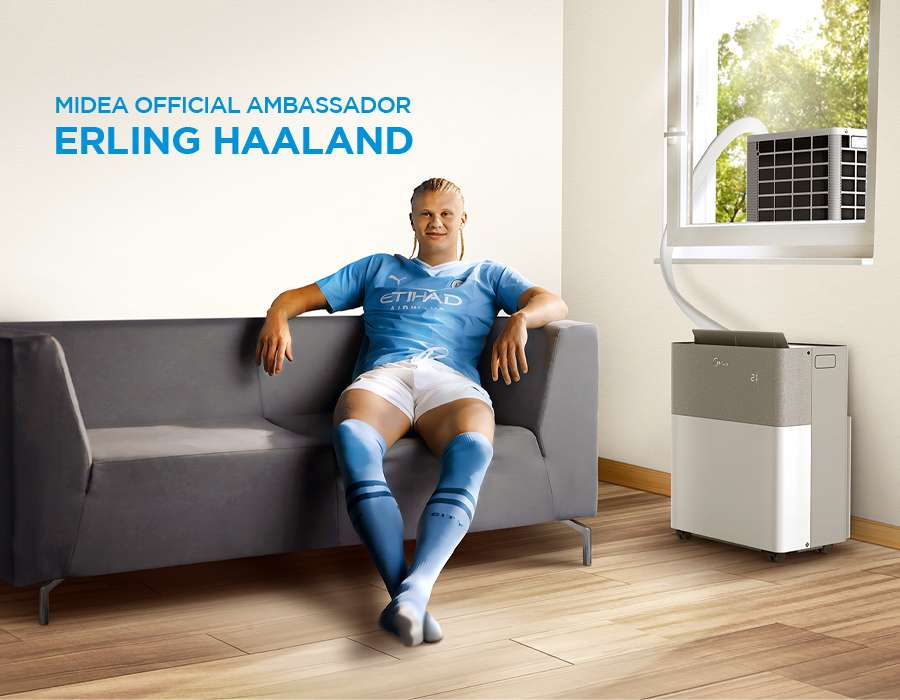

During the weekend I had some friends/colleagues over. The temperature in Munich was around 35°C for this specific day, so they decided to take shelter in my living room, as I had recently gotten the Midea Portasplit.

We spent a lot of time just staring at this magic little happiness inducing box, talking about specs, how hard it was to get one and laughing at the scalpers on Kleinanzeigen.

{: style="width: 70%" }

I imagine it wasn't all that different from back in the days of color television, where somebody in the neighborhood would get one of those fancy new devices and at least 3 families worth of neighbors would cram into their place to take a look. I guess that with the ease of purchasing nowadays, people just don't have these instances anymore.
